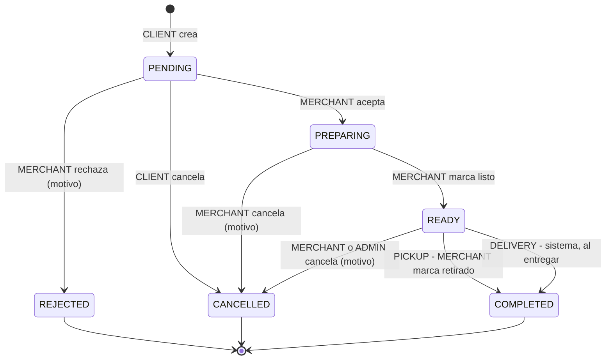
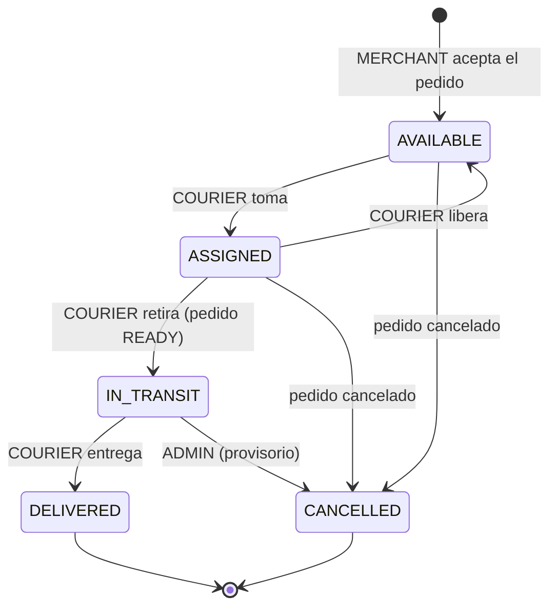

# UrbanDelivery — Casos de pedido y máquinas de estado

Respuesta a la 2.ª devolución del tutor. Antes de cerrar el ER se modelan tres casos completos para definir **estados, transiciones, actor autorizado e información que se conserva**. Este documento reemplaza la tabla de transiciones de [02-actualizacion.md §6](02-actualizacion.md#6-reglas-de-negocio-críticas-flujo-de-pedido).

> Nombres de tablas, columnas y estados en inglés (código y base). Documentación en español.

---

## 1. Decisiones de modelo

| Tema | Decisión | Por qué (evidencia) |
|------|----------|---------------------|
| Preparación vs. entrega | **Dos máquinas de estado**: `orders.status` (lado comercio) y `deliveries.status` (lado cadete) | Que un cadete tome un envío no significa que el pedido esté en camino; puede seguir preparándose |
| Estado LISTO | `READY` explícito en el pedido | Dolor repetido en farmacia, rotisería y veterinaria: "el cliente no sabe si está listo" |
| Retiro o envío | `orders.fulfillment_type` = `PICKUP` \| `DELIVERY`. La fila en `deliveries` **solo se crea para DELIVERY** y recién cuando el comercio acepta | Muchos clientes encargan y retiran; varios comercios combinan ambas modalidades |
| Rechazo vs. cancelación | **Rechazo** = comercio, solo en `PENDING`. **Cancelación** = cliente solo en `PENDING`; después de aceptado, solo el comercio y con motivo | Si el comercio ya empezó a preparar, la cancelación del cliente genera un costo |
| Disponibilidad | `products.available` se activa/desactiva con un click. Sin inventario | Evita recibir pedidos que después hay que rechazar |
| Precio histórico | `order_items` copia `product_name` y `unit_price` al crear el pedido | Cambios de catálogo no alteran pedidos históricos |
| Costo de envío | Tarifa fija por comercio (`merchants.delivery_fee`, `0` = incluido), copiada a `orders.delivery_fee`. El cadete la ve antes de tomar y **la cobra al cliente contra entrega** | Sin "a acordar": no reintroducir negociación manual. Hoy los comercios fijan el costo o no lo cobran |
| Trazabilidad | `order_status_history` registra cada transición: entidad, desde, hacia, actor, motivo y fecha | Conservar quién hizo cada cambio y cuándo |

El cobro de los productos sigue fuera de la app (pago contra entrega o acuerdo offline, como en la propuesta).

---

## 2. Máquina de estados del pedido (`orders.status`)

| Desde → Hacia | Actor | Precondición | Efecto / datos que se guardan |
|---------------|-------|--------------|-------------------------------|
| — → `PENDING` | CLIENT | Comercio aprobado; todos los productos `available` y del mismo comercio; la modalidad está habilitada en el comercio | Copia `unit_price` y `product_name` en cada ítem; copia `delivery_fee` (0 si es PICKUP); `created_at` |
| `PENDING` → `PREPARING` | MERCHANT (dueño) | — | Si es DELIVERY: crea `deliveries` en `AVAILABLE`; `accepted_at` |
| `PENDING` → `REJECTED` | MERCHANT (dueño) | — | `status_reason` obligatorio |
| `PENDING` → `CANCELLED` | CLIENT (autor) | — | Sin costo; `status_reason` opcional |
| `PREPARING` → `READY` | MERCHANT (dueño) | — | `ready_at` |
| `PREPARING`/`READY` → `CANCELLED` | MERCHANT (dueño) | La entrega, si existe, no está `IN_TRANSIT` | `status_reason` obligatorio; la entrega pasa a `CANCELLED` |
| `READY` → `CANCELLED` | ADMIN *(provisorio)* | La entrega está `IN_TRANSIT` y no pudo completarse | `status_reason` obligatorio; la entrega pasa a `CANCELLED` |
| `READY` → `COMPLETED` | MERCHANT (dueño) | `fulfillment_type = PICKUP` | `completed_at` (cliente retiró) |
| `READY` → `COMPLETED` | Sistema | La entrega pasa a `DELIVERED` | `completed_at`, en la misma transacción |

## 3. Máquina de estados de la entrega (`deliveries.status`)

Existe **solo** si `orders.fulfillment_type = DELIVERY`.

| Desde → Hacia | Actor | Precondición | Efecto |
|---------------|-------|--------------|--------|
| — → `AVAILABLE` | Sistema (al aceptar el MERCHANT) | Pedido DELIVERY pasa a `PREPARING` | Aparece en la bandeja común de cadetes |
| `AVAILABLE` → `ASSIGNED` | COURIER aprobado | Pedido en `PREPARING` o `READY` | `courier_id`, `assigned_at`. **Asignación atómica**: `UPDATE … WHERE status = 'AVAILABLE'` + `@Version` |
| `ASSIGNED` → `AVAILABLE` | COURIER asignado | Todavía no retiró | `courier_id = null`; queda registrado en el historial |
| `ASSIGNED` → `IN_TRANSIT` | COURIER asignado | Pedido en `READY` | `picked_up_at` |
| `IN_TRANSIT` → `DELIVERED` | COURIER asignado | — | `delivered_at`; el pedido pasa a `COMPLETED` |
| `AVAILABLE`/`ASSIGNED` → `CANCELLED` | Sistema | El MERCHANT canceló el pedido | Libera al cadete |
| `IN_TRANSIT` → `CANCELLED` | Sistema | ADMIN canceló el pedido *(provisorio)* | Queda el motivo en el historial |

**Antes de tomar, el cadete ve:** comercio y dirección de retiro, dirección y referencia de entrega, ítems, notas, estado de preparación y `delivery_fee`.

## 4. Estado que ve el cliente (derivado)

| `orders.status` | `deliveries.status` | Etiqueta |
|-----------------|---------------------|----------|
| `PENDING` | — | Esperando al comercio |
| `PREPARING` | — / `AVAILABLE` | En preparación |
| `PREPARING` | `ASSIGNED` | En preparación · cadete asignado |
| `READY` | — (PICKUP) | Listo para retirar |
| `READY` | `AVAILABLE` / `ASSIGNED` | Listo · esperando al cadete |
| `READY` | `IN_TRANSIT` | En camino |
| `COMPLETED` | — / `DELIVERED` | Retirado / Entregado |
| `REJECTED` / `CANCELLED` | — | Rechazado / Cancelado + motivo |

No se guarda como columna; la API lo calcula.

---

## 5. Casos completos

### Pedido A — envío con cadete

Cliente elige envío, comercio acepta y prepara, un cadete toma la entrega, el pedido queda listo, el cadete lo retira y entrega.

| # | Actor | Transición | Filas creadas / modificadas | Información que se conserva |
|---|-------|------------|-----------------------------|-----------------------------|
| 1 | CLIENT | orden: — → `PENDING` | INSERT `orders` (DELIVERY), INSERT `order_items` ×N, INSERT `order_status_history` | Precio y nombre de cada producto, `delivery_fee` copiado, dirección + referencia, notas, `created_at` |
| 2 | MERCHANT | orden: `PENDING` → `PREPARING`; entrega: — → `AVAILABLE` | UPDATE `orders`, **INSERT `deliveries`**, INSERT historial ×2 | `accepted_at`; actor = comercio |
| 3 | COURIER | entrega: `AVAILABLE` → `ASSIGNED` | UPDATE `deliveries` (atómico), INSERT historial | `courier_id`, `assigned_at`. Pedido sigue en `PREPARING`: el cliente ve "En preparación · cadete asignado" |
| 4 | MERCHANT | orden: `PREPARING` → `READY` | UPDATE `orders`, INSERT historial | `ready_at` |
| 5 | COURIER | entrega: `ASSIGNED` → `IN_TRANSIT` | UPDATE `deliveries`, INSERT historial | `picked_up_at` (retiro por cadete) |
| 6 | COURIER | entrega: `IN_TRANSIT` → `DELIVERED`; orden: `READY` → `COMPLETED` | UPDATE `deliveries` + `orders` (misma transacción), INSERT historial ×2 | `delivered_at`, `completed_at`; cadete cobra `delivery_fee` |

### Pedido B — retiro sin cadete

| # | Actor | Transición | Filas creadas / modificadas | Información que se conserva |
|---|-------|------------|-----------------------------|-----------------------------|
| 1 | CLIENT | orden: — → `PENDING` | INSERT `orders` (PICKUP, `delivery_fee = 0`, sin dirección), INSERT `order_items` ×N, INSERT historial | Precios y nombres copiados, `created_at` |
| 2 | MERCHANT | orden: `PENDING` → `PREPARING` | UPDATE `orders`, INSERT historial | `accepted_at`. **No se crea `deliveries`** |
| 3 | MERCHANT | orden: `PREPARING` → `READY` | UPDATE `orders`, INSERT historial | `ready_at`; el cliente ve "Listo para retirar" |
| 4 | MERCHANT | orden: `READY` → `COMPLETED` | UPDATE `orders`, INSERT historial | `completed_at` (cliente retiró) |

El ciclo completo nunca toca `deliveries` ni requiere un COURIER.

### Pedido C — rechazo por producto no disponible

| # | Actor | Transición | Filas creadas / modificadas | Información que se conserva |
|---|-------|------------|-----------------------------|-----------------------------|
| 1 | CLIENT | orden: — → `PENDING` | INSERT `orders`, INSERT `order_items` ×N, INSERT historial | Igual que A/B |
| 2 | MERCHANT | orden: `PENDING` → `REJECTED` | UPDATE `orders` (`status_reason`), INSERT historial | Motivo (ej. "Sin stock: empanadas de carne"), actor, fecha |
| 3 | MERCHANT | *(no es transición de pedido)* | UPDATE `products.available = false` | Nuevos clientes ya no pueden agregar el producto |

Como el rechazo ocurre antes de aceptar, **nunca se crea `deliveries`** aunque el pedido fuera DELIVERY.

---

## 6. Temas abiertos y regla provisoria

| Tema | Regla provisoria P0 | Se valida con |
|------|---------------------|---------------|
| El cadete no puede entregar después de retirar | Se resuelve fuera de la app; ADMIN puede cancelar el pedido con motivo | Entrevistas a cadetes ([guía](relevamiento/guia-cadetes.md)) |
| ¿Existe oferta de cadetes independientes? | Se mantiene COURIER en P0. Si no se valida: retiro + reparto propio del comercio. El esquema no cambia porque `deliveries` ya es opcional | Entrevistas a cadetes |
| Cancelación después de aceptar | Solo el comercio, con motivo | Consulta a comercios ([guía](relevamiento/guia-cadetes.md#pregunta-para-comercios)) |
| Quién cobra el envío | El cadete cobra `delivery_fee` al cliente | Entrevistas a cadetes |

## 7. Próximos pasos (fuera de este documento)

1. Entrevistar cadetes y consultar la regla de cancelación a comercios.
2. **Spike de seguridad temprano:** login → JWT → endpoint protegido → validación por rol.
3. **Deploy mínimo temprano** (API + DB en Render, front en Vercel) y seguir trabajando local.
4. Cerrar el [modelo ER](04-modelo-er.md) con estos casos.
