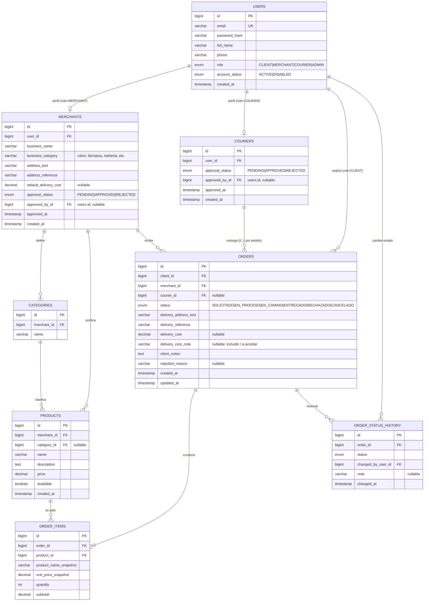

# UrbanDelivery — Esquema de Base de Datos y Listado de Módulos (2.ª Entrega)

| Campo | Dato |
|-------|------|
| **Proyecto** | UrbanDelivery |
| **Equipo** | Hillar, Saul · Diaz, Agustin |
| **Tutor** | Londero, Oscar |
| **Fecha** | Septiembre 2026 |
| **Base** | Reglas de negocio de [02-actualizacion.md](02-actualizacion.md), sección 6 |

Este documento cubre el hito **≤ 27/09** (condición de regularidad): esquema de base de datos (ER) y listado de módulos del backend, acotados al alcance **P0** del MVP.

---

## 1. Modelo entidad-relación (P0)

### 1.1 Decisiones de diseño

- **Un solo `users`** con `role` (`CLIENT`, `MERCHANT`, `COURIER`, `ADMIN`) para login/JWT simple. Los datos específicos de comercio y cadete van en tablas de perfil 1:1 (`merchants`, `couriers`), que además guardan el estado de aprobación del ADMIN.
- **Carrito no se persiste**: la restricción "mono-comercio" es una regla de UI/estado de frontend antes de confirmar el pedido. Lo único que persiste es el `order` ya confirmado, que referencia un único `merchant_id` — así el invariante "un pedido = un comercio" queda garantizado por el propio modelo (fuera de alcance el multi-comercio, según 01-propuesta.md §2.3).
- **Un cadete por pedido** se garantiza con la columna `courier_id` en `orders` (nullable hasta que alguien lo toma) y una actualización atómica (`UPDATE ... WHERE courier_id IS NULL`), sin necesidad de tabla intermedia.
- **`order_status_history`** registra cada cambio de estado (quién y cuándo) para dar la trazabilidad que pidieron los consumidores en el relevamiento, sin necesitar WebSockets (se consulta por polling).
- **Costo de envío**: `delivery_cost` (numérico, opcional) + `delivery_cost_note` (texto libre para "incluido" / "a acordar"), según regla de negocio (sin cálculo por km).
- **Dirección**: texto + referencia, sin geolocalización (fuera de alcance P0/P1 según 01-propuesta.md).

### 1.2 Diagrama (Mermaid ER)

### 1.3 Invariantes clave modeladas

| Invariante | Cómo se garantiza |
|---|---|
| Un pedido pertenece a un solo comercio | `orders.merchant_id` único por fila (no hay tabla de líneas multi-comercio) |
| Un pedido tiene a lo sumo un cadete asignado | `orders.courier_id` nullable + update atómico condicionado (`WHERE courier_id IS NULL`) |
| MERCHANT/COURIER deben estar aprobados por ADMIN antes de operar | `approval_status` en `merchants`/`couriers`; el backend valida `APPROVED` antes de publicar catálogo o tomar pedidos |
| Historial de estados para trazabilidad | `order_status_history` inserta una fila en cada transición válida |
| Precio del producto no cambia retroactivamente en pedidos ya hechos | `order_items` guarda `product_name_snapshot` y `unit_price_snapshot` |

---

## 2. Listado de módulos (backend, arquitectura por capas)

| # | Módulo | Responsabilidad | Prioridad |
|---|--------|------------------|-----------|
| 1 | **Auth & Seguridad** | Registro/login, emisión y validación de JWT, `@PreAuthorize` por rol | P0 |
| 2 | **Usuarios y Perfiles** | CRUD de `users`; alta de perfil `merchants`/`couriers` asociado a un usuario | P0 |
| 3 | **Moderación (Admin)** | Listar altas pendientes, aprobar/rechazar `merchants` y `couriers` | P0 |
| 4 | **Catálogo** | CRUD de `categories` y `products` por comercio; listado público para clientes | P0 |
| 5 | **Pedidos (Orders)** | Creación de pedido desde carrito de frontend (mono-comercio), cálculo de `order_items` y total | P0 |
| 6 | **Máquina de estados del pedido** | Transiciones válidas (`Solicitado → En proceso → En camino → Entregado`, más `Rechazado`/`Cancelado`), reglas de quién puede cambiar cada estado, escritura en `order_status_history` | P0 |
| 7 | **Panel Comercio** | Bandeja de pedidos entrantes, aceptar/rechazar (con motivo), gestión de catálogo propio | P0 |
| 8 | **Panel Cadete** | Ver pedidos "En proceso" disponibles, tomar uno (asignación atómica), marcar "En camino"/"Entregado", liberar si abandona | P0 |
| 9 | **Panel Admin** | Dashboard de moderación (módulo 3) + listados generales | P0 |
| 10 | **Mandados generales** | Entidad de mandado sin catálogo asociado, mismo ciclo de estados que un pedido | P1 |
| 11 | **Búsqueda / filtros de catálogo** | Filtro por nombre/categoría en listado de comercios y productos | P1 |
| 12 | **Notificaciones por polling** | Endpoint de estado consultable por frontend a intervalos (sin WebSockets) | P1 |

### 2.1 Mapeo módulo → entidades

- Auth & Seguridad → `users`
- Usuarios y Perfiles → `users`, `merchants`, `couriers`
- Moderación (Admin) → `merchants.approval_status`, `couriers.approval_status`
- Catálogo → `categories`, `products`
- Pedidos → `orders`, `order_items`
- Máquina de estados → `orders.status`, `order_status_history`
- Panel Comercio / Panel Cadete → lecturas y transiciones filtradas por rol sobre `orders`

### 2.2 Fuera de este esquema (explícito, ver 01-propuesta.md §2.3)

Pagos online, geolocalización/ruteo, WebSockets/push, chat in-app y ratings no agregan entidades en P0; si se implementan en el futuro (P2) requerirán tablas propias (`payments`, `ratings`, etc.) fuera de este alcance.

---

## 3. Próximo paso

Con este esquema aprobado, la fundación técnica (Spring Boot + PostgreSQL vía Docker Compose + JPA) puede mapear cada entidad a `@Entity` y arrancar el *vertical slice*: registro/login → listar comercios → crear pedido → aceptar (merchant) → tomar y entregar (courier).
