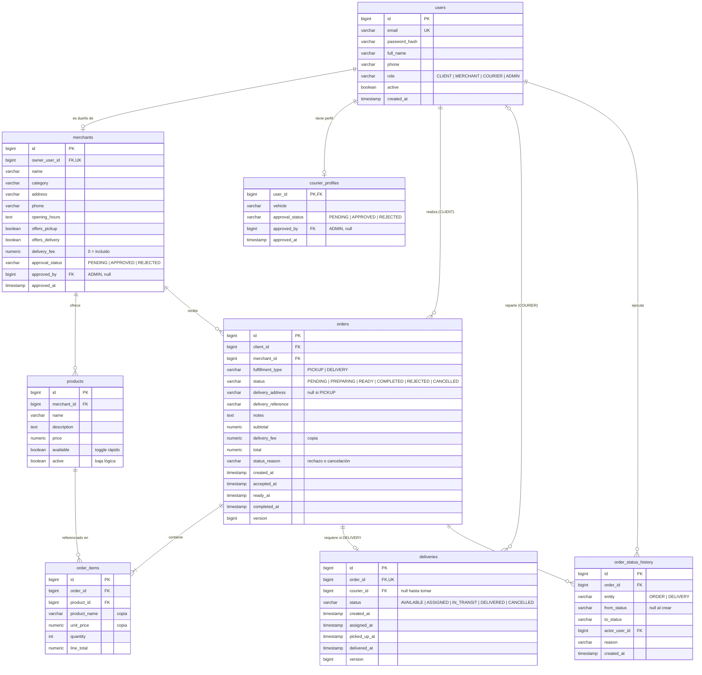

# UrbanDelivery — Modelo Entidad-Relación

Construido a partir de los casos A, B y C y de las máquinas de estado de [03-casos-y-estados.md](03-casos-y-estados.md). Base: PostgreSQL con Spring Data JPA.

---

## 1. Diagrama

`merchants.approved_by` y `courier_profiles.approved_by` también referencian a `users` (ADMIN); se omiten del diagrama para que sea legible.

---

## 2. Diccionario de datos

### `users`
| Columna | Tipo | Null | Restricciones |
|---------|------|------|---------------|
| id | bigint | no | PK, identity |
| email | varchar(255) | no | UNIQUE |
| password_hash | varchar(255) | no | BCrypt |
| full_name | varchar(120) | no | |
| phone | varchar(30) | sí | |
| role | varchar(20) | no | CHECK en (CLIENT, MERCHANT, COURIER, ADMIN) |
| active | boolean | no | default true |
| created_at | timestamp | no | default now() |

### `merchants`
| Columna | Tipo | Null | Restricciones |
|---------|------|------|---------------|
| id | bigint | no | PK |
| owner_user_id | bigint | no | FK → users, UNIQUE (un comercio por usuario MERCHANT) |
| name | varchar(120) | no | |
| category | varchar(60) | sí | Texto libre en P0 (farmacia, rotisería…) |
| address | varchar(255) | no | Dirección de retiro |
| phone | varchar(30) | sí | |
| opening_hours | text | sí | Texto libre en P0 |
| offers_pickup | boolean | no | default true |
| offers_delivery | boolean | no | default false. CHECK: `offers_pickup OR offers_delivery` |
| delivery_fee | numeric(10,2) | no | default 0; CHECK ≥ 0 |
| approval_status | varchar(20) | no | CHECK en (PENDING, APPROVED, REJECTED); default PENDING |
| approved_by | bigint | sí | FK → users (ADMIN) |
| approved_at | timestamp | sí | |

### `courier_profiles`
| Columna | Tipo | Null | Restricciones |
|---------|------|------|---------------|
| user_id | bigint | no | PK, FK → users |
| vehicle | varchar(40) | sí | bici, moto, auto… |
| approval_status | varchar(20) | no | CHECK en (PENDING, APPROVED, REJECTED); default PENDING |
| approved_by | bigint | sí | FK → users (ADMIN) |
| approved_at | timestamp | sí | |

### `products`
| Columna | Tipo | Null | Restricciones |
|---------|------|------|---------------|
| id | bigint | no | PK |
| merchant_id | bigint | no | FK → merchants |
| name | varchar(120) | no | |
| description | text | sí | |
| price | numeric(10,2) | no | CHECK > 0 |
| available | boolean | no | default true. Disponibilidad básica, sin inventario |
| active | boolean | no | default true. Baja lógica: los pedidos históricos siguen referenciando el producto |

### `orders`
| Columna | Tipo | Null | Restricciones |
|---------|------|------|---------------|
| id | bigint | no | PK |
| client_id | bigint | no | FK → users |
| merchant_id | bigint | no | FK → merchants |
| fulfillment_type | varchar(10) | no | CHECK en (PICKUP, DELIVERY) |
| status | varchar(20) | no | CHECK en (PENDING, PREPARING, READY, COMPLETED, REJECTED, CANCELLED) |
| delivery_address | varchar(255) | sí | CHECK: no null si DELIVERY |
| delivery_reference | varchar(255) | sí | |
| notes | text | sí | |
| subtotal | numeric(10,2) | no | Suma de `line_total` |
| delivery_fee | numeric(10,2) | no | Copia de `merchants.delivery_fee`. CHECK: `= 0` si PICKUP |
| total | numeric(10,2) | no | `subtotal + delivery_fee` |
| status_reason | varchar(255) | sí | CHECK: no null si `status = REJECTED` |
| created_at | timestamp | no | |
| accepted_at | timestamp | sí | |
| ready_at | timestamp | sí | |
| completed_at | timestamp | sí | |
| version | bigint | no | Bloqueo optimista (`@Version`) |

### `order_items`
| Columna | Tipo | Null | Restricciones |
|---------|------|------|---------------|
| id | bigint | no | PK |
| order_id | bigint | no | FK → orders |
| product_id | bigint | no | FK → products |
| product_name | varchar(120) | no | Copia al comprar |
| unit_price | numeric(10,2) | no | Copia al comprar |
| quantity | int | no | CHECK > 0 |
| line_total | numeric(10,2) | no | `unit_price × quantity` |

### `deliveries`
| Columna | Tipo | Null | Restricciones |
|---------|------|------|---------------|
| id | bigint | no | PK |
| order_id | bigint | no | FK → orders, **UNIQUE** (un pedido tiene 0 o 1 entrega) |
| courier_id | bigint | sí | FK → users (COURIER). CHECK: no null si status en (ASSIGNED, IN_TRANSIT, DELIVERED) |
| status | varchar(20) | no | CHECK en (AVAILABLE, ASSIGNED, IN_TRANSIT, DELIVERED, CANCELLED) |
| created_at | timestamp | no | |
| assigned_at | timestamp | sí | |
| picked_up_at | timestamp | sí | |
| delivered_at | timestamp | sí | |
| version | bigint | no | Bloqueo optimista (`@Version`) |

El costo que ve el cadete se lee de `orders.delivery_fee`; no se duplica en `deliveries`.

### `order_status_history`
| Columna | Tipo | Null | Restricciones |
|---------|------|------|---------------|
| id | bigint | no | PK |
| order_id | bigint | no | FK → orders |
| entity | varchar(10) | no | CHECK en (ORDER, DELIVERY) |
| from_status | varchar(20) | sí | null en la creación |
| to_status | varchar(20) | no | |
| actor_user_id | bigint | sí | FK → users. Null cuando el cambio lo hace el sistema |
| reason | varchar(255) | sí | |
| created_at | timestamp | no | |

Índices sugeridos: `orders(merchant_id, status)` para la bandeja del comercio, `orders(client_id, created_at)` para el historial del cliente, `deliveries(status)` para la bandeja de cadetes y `order_status_history(order_id, created_at)`.

---

## 3. Invariantes

| # | Invariante | Dónde se garantiza |
|---|-----------|--------------------|
| 1 | Un pedido PICKUP nunca tiene fila en `deliveries` | Servicio (solo se crea al aceptar un DELIVERY) |
| 2 | Un pedido tiene como máximo una entrega | UNIQUE `deliveries.order_id` |
| 3 | Dos cadetes no pueden tomar la misma entrega | `UPDATE deliveries SET courier_id=?, status='ASSIGNED' WHERE id=? AND status='AVAILABLE'` + `@Version` |
| 4 | Todos los ítems de un pedido son del mismo comercio | Servicio al crear el pedido (el carrito vive en el frontend) |
| 5 | Solo se piden productos `available` y `active` de un comercio APPROVED | Servicio al crear el pedido |
| 6 | El cadete retira solo cuando el pedido está READY | Servicio (transición `ASSIGNED → IN_TRANSIT`) |
| 7 | Entregar cierra el pedido | Misma transacción: `DELIVERED` + `COMPLETED` |
| 8 | Precios históricos inmutables | `order_items.unit_price` / `product_name` copiados |
| 9 | DELIVERY tiene dirección; PICKUP no cobra envío | CHECK en `orders` |
| 10 | Rechazo con motivo | CHECK `status_reason` en `orders` |
| 11 | Cada transición queda registrada con actor | INSERT en `order_status_history` en la misma transacción |
| 12 | Solo el actor autorizado cambia cada estado | Spring Security (rol) + verificación de propiedad (dueño del comercio, cadete asignado, autor del pedido) |

---

## 4. Casos × tablas

| Caso | users | merchants | products | orders | order_items | deliveries | order_status_history |
|------|:-----:|:---------:|:--------:|:------:|:-----------:|:----------:|:--------------------:|
| **A** — envío con cadete | lee | lee | lee | INSERT + 3 UPDATE | INSERT ×N | INSERT + 3 UPDATE | 8 filas |
| **B** — retiro | lee | lee | lee | INSERT + 3 UPDATE | INSERT ×N | **no se usa** | 4 filas |
| **C** — rechazo | lee | lee | UPDATE `available` | INSERT + 1 UPDATE | INSERT ×N | **no se usa** | 2 filas |

---

## 5. Fuera del modelo P0

Carrito persistido, categorías como tabla, horarios estructurados, zonas, pagos, calificaciones y mandados (P1). Se agregan cuando haga falta sin romper las tablas anteriores.
